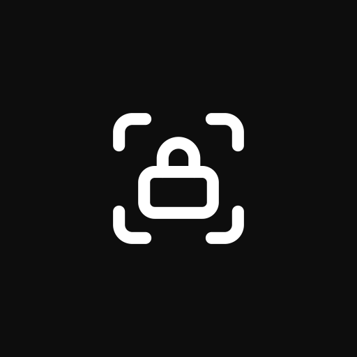
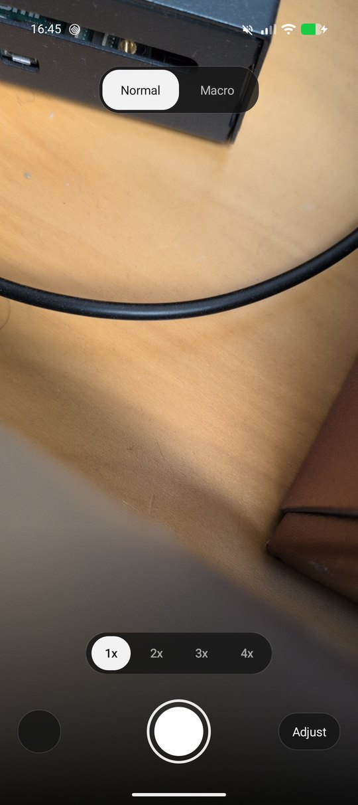
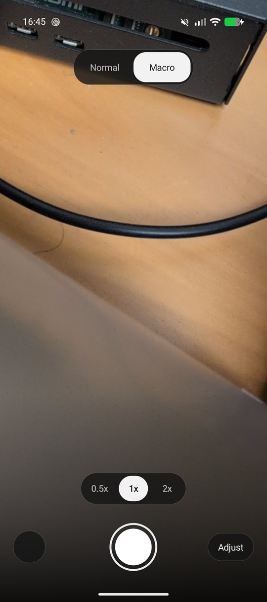
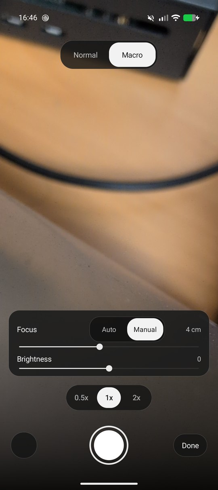

  

<h1 align="center">LensLock</h1>

<strong>The lens you picked, and nothing else.</strong> A small Android camera that pins one physical sensor so macro shots stop jumping lenses.

  <a href="https://github.com/simisonne/lenslock/releases/latest"><strong>Download</strong></a> ·
  <a href="#what-it-does">Features</a> ·
  <a href="#install">Install</a> ·
  <a href="#shooting">Shooting</a> ·
  <a href="#under-the-hood">Under the hood</a> ·
  <a href="#privacy">Privacy</a>

  
  
  

Pixels hand the whole rear cluster to apps as one logical camera. The driver decides which
sensor answers, and when the subject gets close it swaps to the ultrawide on its own. With a
clip on macro lens that swap lands on the wrong glass, and with a plain macro shot it moves the
frame at the worst moment.

LensLock opens that cluster and pins a single sensor into both the preview and the still capture
for the whole session, so every frame comes from the lens you chose.

**One sensor per session. The app never changes lens on its own.**

  
  &nbsp;&nbsp;
  

## What it does

| Feature | What you can do |
| --- | --- |
| **Lens lock** | **Normal** and **Macro** at the top pick the sensor. The choice is stored and restored on the next launch. Both outputs carry the physical camera id, so the driver has no route to another sensor mid session. |
| **Zoom** | Field of view from 0.5x to 4x, read as a field of view rather than a crop factor. Pinch anywhere on the preview and the indicator slides between the markers while the live value counts up. Tapping a marker jumps to it. The row only offers the pinned sensor's range, so nothing there can change lens. |
| **Focus** | Auto or Manual in the Adjust panel. Manual runs a distance slider in centimetres, which is how the ultrawide reaches its 2cm close focus without hunting. |
| **Brightness** | Exposure compensation in half stops from the same panel. |
| **Focus point** | Tap the preview and an amber square marks the spot, with the metering region sent to the sensor. |
| **Files** | Full resolution JPEG into `DCIM/Camera`, the folder GrapheneOS Camera uses, with `IMG_` names. The picture is rotated to match how the phone was held, so viewers need no EXIF hints. |
| **Last shot** | The round thumbnail bottom left opens the photo you just took. |
| **Held any way** | The interface follows the device orientation, and the file rotation follows the pose you shot in. |

  

## Install

Download `lenslock-1.6.apk` from [Releases](https://github.com/simisonne/lenslock/releases/latest)
and open it on a phone running Android 13 or newer, or push it over `adb`.

| Step | Command |
| --- | --- |
| Install the release | `adb install -r lenslock-1.6.apk` |
| Get the code | `git clone https://github.com/simisonne/lenslock.git` |
| Point Gradle at your SDK | `echo "sdk.dir=/path/to/Android/sdk" > local.properties` |
| Build the APK | `./gradlew assembleDebug` |
| Install your build | `adb install -r app/build/outputs/apk/debug/app-debug.apk` |
| Build the release | `./gradlew assembleRelease` |

The release APK is signed with the standard Android debug key, the same one every debug build
uses, so it installs over an older copy and keeps your saved lens choice. That key is fine for
sideloading, it cannot be used for a Play Store upload.

Building from source needs JDK 21 and an Android SDK with platform 37. There are no libraries to
download, the app is plain Java on Camera2 with hand drawn views.

## Shooting

1. Open the app and pick **Normal** or **Macro** at the top. Macro is the ultrawide, the one that
   focuses to 2cm.
2. Frame the subject. Pinch to set the field of view, or tap a marker for 1x, 2x and so on.
3. For the closest distances open **Adjust**, switch Focus to **Manual** and bring the slider
   down until the detail snaps in. The distance is shown in cm as you move it.
4. Tap the preview to move the focus point when auto is hunting, and use Brightness when the
   subject sits against a bright background.
5. Press the shutter. The photo lands in `DCIM/Camera` with the rest of your camera roll.

## Under the hood

- `CameraEngine` owns Camera2 with one thread for camera calls and another for callbacks, and a
  single thread executor for the JPEG work.
- The session is configured with `OutputConfiguration.setPhysicalCameraId` on the preview and the
  still reader, which is the only way to pin a sensor. Changing lens rebuilds the session, about
  200ms, because the physical id and the zoom are fixed at configure time.
- Sensors are matched by focal length from `CameraCharacteristics.getPhysicalCameraIds`, never by
  a hardcoded id. On a Pixel 9 that is physical 2 at 6.9mm for Normal and physical 3 at 2.02mm
  for Macro.
- The still reader is sized from the pinned sensor's own JPEG sizes. Asking the logical camera
  for its size makes the driver hand back a downscaled square.
- The viewfinder transform undoes the TextureView stretch with the aspect the surface actually
  presents, read from `SurfaceTexture.getTransformMatrix`, then rotates and applies one uniform
  scale. Using the requested stream size instead is what stretches a preview.
- File rotation is `SENSOR_ORIENTATION - display rotation`. The viewfinder carries its own small
  offset on top, because the matrix runs in view space and reads the opposite way round.
- `JpegSaver` centre crops for zoom, rotates, and writes through `MediaStore`. `ZoomSlider` draws
  the markers and interpolates the indicator from the live zoom.
- `probe-ref/` holds the throwaway probe app that produced these findings, including the session
  that was caught changing sensor on its own.

## Privacy

The app declares one permission, `CAMERA`, and no `INTERNET`. Nothing is uploaded, there are no
analytics and no accounts. Photos are written to your own `DCIM/Camera` folder.

## Known limits

- Sensors are found by focal length, so other Pixels should behave the same. Only a Pixel 9 was
  tested.
- There is no HDR and no multi frame stacking. The file is the plain sensor JPEG, which is the
  point for controlled macro work but not what the stock camera produces in low light.
- A pinned stream ignores zoom requests, so all zoom here is a centre crop in the app rather than
  optical or sensor zoom.
- The ultrawide's own field is 0.5x, which caps its range at 2x. The 3x and 4x markers belong to
  Normal for that reason.
- The layout is tuned for portrait. Landscape works, the controls run along the bottom in one row.

## License

MIT, see [LICENSE](LICENSE).
